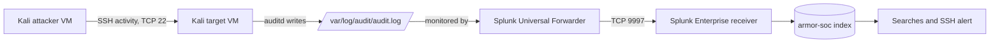
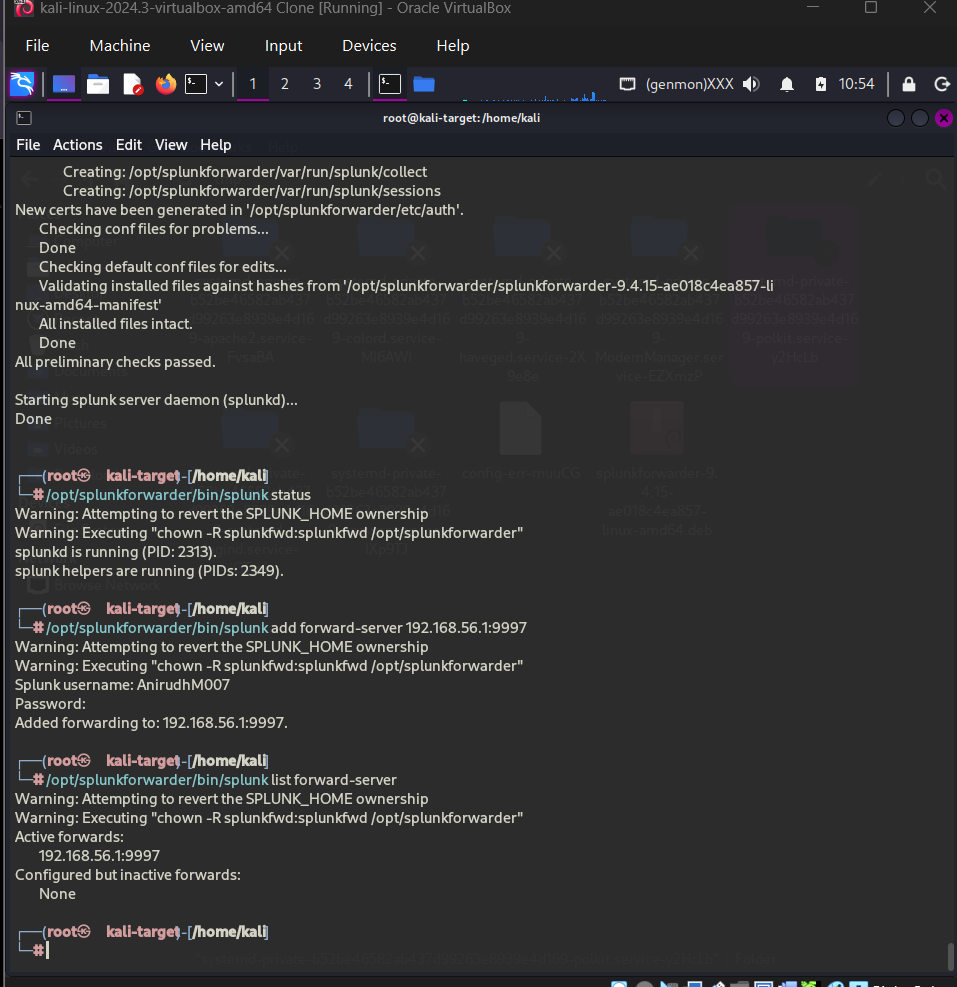
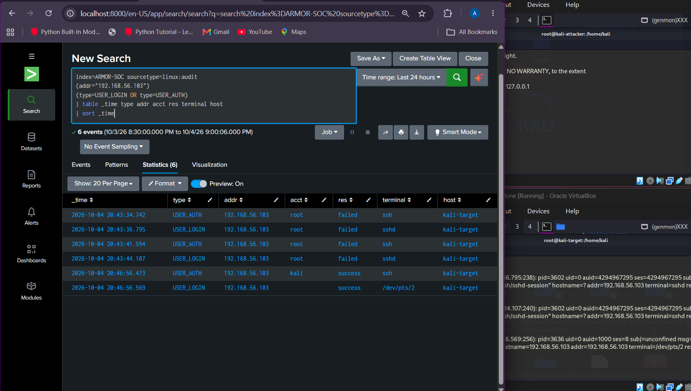
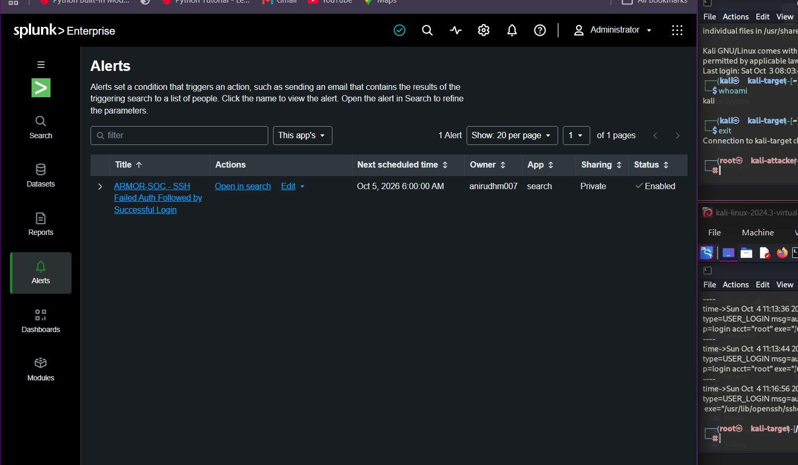

# Splunk SOC Lab: SSH Activity Monitoring

A reproducible blue-team lab that forwards Linux audit events from a Kali target into Splunk Enterprise, where SSH login activity can be investigated and a failed-then-successful login pattern can raise an alert.

> **Status:** The supplied screenshots document a working run: the target Universal Forwarder connected to Splunk at `192.168.56.1:9997`, audit events appeared in the `armor-soc` index as `linux:audit`, and an SSH detection alert was enabled. The `.conf` files here are clean reference examples reconstructed from that evidence, not exports from the live machines.

## What it demonstrates

- Splunk receiving on TCP `9997` for Universal Forwarder traffic.
- Splunk Universal Forwarder on Kali monitoring `/var/log/audit/audit.log`.
- A dedicated Splunk index for audit events.
- SPL searches summarizing event types, accounts, outcomes, and source addresses.
- An enabled SSH alert based on repeated failed logins and a successful login from the same remote IP.

## Architecture

The screenshots show target host `kali-target`, receiver `192.168.56.1:9997`, and observed SSH source `192.168.56.103`. These are values from a host-only lab network; replace them for your environment.

## Repository map

| Path | Purpose |
| --- | --- |
| `docs/architecture.md` | Component roles, data path, and detection flow |
| `docs/setup.md` | Rebuild guide |
| `docs/evidence.md` | Screenshot catalog |
| `configs/universal-forwarder/` | Example audit monitor and forwarding destination |
| `configs/splunk-receiver/` | Example receiver and index stanzas |
| `searches/` | SSH correlation and investigation searches |
| `evidence/` | Screenshots documenting the lab |

## Quick start

1. Create three roles: Splunk Enterprise, a Kali target, and a Kali attacker. Isolate them on a controlled virtual network.
2. Create the `armor-soc` index in Splunk and enable receiving on TCP `9997`.
3. Install Universal Forwarder on the target. Put the example `inputs.conf` and `outputs.conf` in a local forwarder app or `$SPLUNK_HOME/etc/system/local/`, adapting the receiver address and paths.
4. Confirm auditd is writing the monitored log and the forwarder has an active connection.
5. Run the searches in `searches/` with an appropriate time range. Review schedule and trigger behavior before enabling an alert.

See [docs/setup.md](docs/setup.md) for details.

## Detection behavior

The SPL groups `USER_LOGIN` events by `remote_ip` across the selected search window. It returns a source with at least two failed login events and one successful event, alongside account names and first/last timestamps. The captured SPL does **not** establish that the success occurred after the failures. It also does not tune a production threshold or suppress expected admin traffic; review the query and alert schedule before relying on it.

## Progress snapshots

**Forwarding and indexing:** Splunk receiving is enabled, and the target forwarder connects to the receiver.

**SSH investigation:** Failed and successful authentication events are visible in Splunk with source address and host fields.

**Detection:** The saved SSH detection alert is enabled.

## Evidence and privacy

The screenshots are cataloged in [docs/evidence.md](docs/evidence.md). They include Splunk UI, terminal, host, and lab-network details. Review each image and remove or redact anything you do not want to publish publicly.

## Safe use

Run simulations only against systems you own or have permission to test. Keep VMs on an isolated lab network. Do not commit credentials, tokens, private keys, or real production logs.

## Notes

- The index is shown as `armor-soc` in Splunk and as `ARMOR-SOC` in captured searches; these refer to the same index.
- Screenshots establish an enabled listener on `9997`, the forwarder destination, source path, sourcetype, and alert state. Exact auditd rules, alert schedule, trigger mode, and full exported Splunk configuration were not provided.
- No license has been selected. Add one before inviting reuse.

