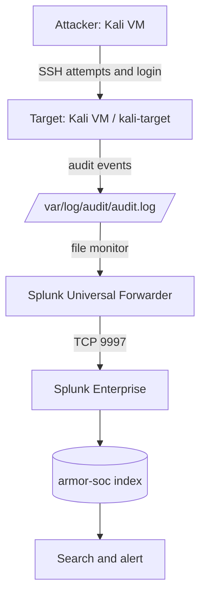
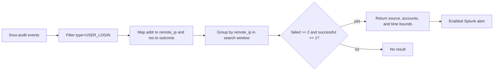

# Architecture and components

## Data path

| Component | Role | Evidence-backed details |
| --- | --- | --- |
| Kali attacker | Initiates SSH sessions | A terminal shows a session to the target; forwarded events include SSH address `192.168.56.103`. |
| Kali target | Runs SSH and produces Linux audit events | Host `kali-target`; source `/var/log/audit/audit.log`. |
| Universal Forwarder | Monitors and forwards the audit log | Installed under `/opt/splunkforwarder`; active destination `192.168.56.1:9997`. |
| Splunk Enterprise | Receives, indexes, searches, and alerts | Web UI on `localhost:8000`; receiving port `9997` enabled. |
| `armor-soc` | Stores forwarded audit events | Visible as an active event index; captured searches use `index=ARMOR-SOC`. |

Captured event metadata includes sourcetype `linux:audit`, source `/var/log/audit/audit.log`, and host `kali-target`. Search results expose fields including `type`, `acct`, `addr`, and `res`. The example configs are reconstructions, not exports of the running system.

## Detection flow

The search aggregates across the selected window. Despite the alert title, the query does not enforce event order. A stronger sequence-aware search should correlate timestamps, and optionally accounts, explicitly.
